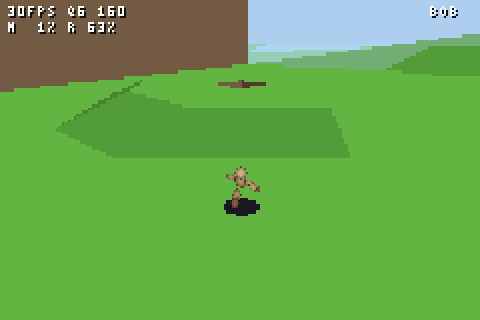

# sm64-gba

[](https://github.com/Kodoque1/sm64-gba/actions/workflows/test.yml)

**Super Mario 64's movement and collision code running on Game Boy Advance
hardware, bit-for-bit identical to a strict IEEE reference**, with a playable
software-rendered demo around it.



*The default build, recorded headless in mGBA by `make demo-video`: each
level's collision mesh, flat shaded, and a wooden mannequin posed by SM64's
own animation data. Nothing in it comes from a ROM. With
`make import ROM=...` it draws Mario's real low-poly model and the levels'
real meshes instead.*

**Built with Claude Opus 5.5.** The code, the test harness and the
engineering notes in this README were written by Claude Opus 5.5
(Anthropic's model). Where the notes say "I", that's the model.

## Why

I know the demoscene values human ingenuity: squeezing a machine by hand is
the point, and a model doing it misses that point. I get it, and this isn't
meant as a demoscene production. But I thought that a demake as close as
possible to the original would be a fun benchmark for an LLM, because it
can't be faked:

- **The target is fixed:** the original game's behavior, not something that
  looks like it.
- **The oracle is strict:** Mario's full state is compared bit for bit, every
  frame, against the unmodified decomp, and deliberately broken builds must
  fail the same checks.
- **The budget is real:** a 16.78 MHz ARM7 with no FPU, 32 KB of fast RAM and
  256 KB of slow RAM, measured with mGBA's cycle timing and cross-checked in
  NanoBoyAdvance, a cycle-accurate emulator.

## Quick start

With Docker (the toolchain is in the `Dockerfile`):

```
git clone https://github.com/Kodoque1/sm64-gba && cd sm64-gba
docker build -t sm64-gba .
docker run --rm -u "$(id -u):$(id -g)" -v "$PWD:/work" sm64-gba \
    sh -c 'make fetch && make test && make gba-opt-test && make demo'
# -> build/demo/sm64demo.gba, open it in mGBA
```

Or install the packages listed in [Using it](#using-it) and run the same
`make` targets directly. CI runs the parity, equivalence, property and demo
checks on every push (`.github/workflows/test.yml`).

## Status

- Milestone 1: the oracle. The unmodified decomp code, built for the GBA, matches
  the reference on every frame of every test.
- Round 1 of optimization: **3.8x faster on average and 5.7x on the worst frame**,
  still bit-exact. Mario's worst frame went from 195% of a 30 Hz game frame to 34%.
- Round 2: **4.9x on average and 8.4x on the worst frame** overall. Mario now
  averages 5.3% of a 30 Hz frame, 23% at worst. Collision is checked against the
  unmodified decomp on 12M direct queries, not just replays.
- **Playable demo:** four levels, software 3D rendering, 30 fps on 99% of
  frames in a scripted tour, with Mario's physics proven identical to the
  reference while you play.
- **Import from your own ROM** (like libsm64): Mario's real low-poly model,
  animated by the game's data, and the levels' real meshes, colored from your
  cartridge's textures. 30 fps on 98% of frames.

## Playable demo

```
make fetch && make demo      # -> build/demo/sm64demo.gba (mGBA, or a flash cart)
make demo-check              # physics check + frame-rate tour, in mGBA
make demo-video              # build/demo/preview.mp4 of the tour (needs ffmpeg)
make skeleton-check          # animated figure vs the game's float matrix chain

make import ROM=path/to/your/sm64.z64   # optional: real Mario model and level meshes
make demo                                # rebuilds with the import (NOIMPORT=1: without)
make import-check ROM=...                # the import's ROM reading vs the decomp's tools

make render-check                        # the renderer vs a z-buffered reference, around pits

make bench-check                         # the bench ROM in mGBA and NanoBoyAdvance
make bench-report SAV=sm64bench.sav      # a bench run from a GBA (see "Testing without a GBA")
make dirty-check                         # the tour with random power-on memory
```

The ROM isn't distributed: it contains code and data compiled from the
decomp, so it's built locally, like the decomp itself.

**Real hardware:** not tested on a GBA yet, only in emulators; see
[Testing without a GBA](#testing-without-a-gba) for how far that goes. The
ROM is built for one: `make demo` writes the Nintendo logo a GBA's BIOS
checks into the header (with devkitPro's gbafix, fetched at build time) and
checks the header as the BIOS does. If you have a flash cart, the bench ROM
below is the most useful thing to run.

**Controls:** D-pad = stick, A = A (jump), B = B (punch, dive, kick), R = Z
(crouch, long jump, ground pound), L + D-pad = rotate and zoom the camera,
Start = next level (Bob-omb Battlefield, Whomp's Fortress, Cool Cool Mountain,
Bowser in the Dark World), Select = performance HUD on/off.

### What is the original game, unchanged

Mario's movement, collision and animation timing are the same bit-exact,
optimized objects as `make gba-opt-test`, at SM64's native 30 Hz, fed by the
same per-frame sequence as the parity harness. `make demo-check` proves it on
the real ROM: the demo logs the exact controller inputs it gives Mario each
frame (stick, buttons, camera yaw), the host reference harness replays them,
and Mario's position matches **bit for bit on every frame** (683 frames of
running, jumps, long jumps, dives, slide kicks, ground pounds and camera
turns). A 32-unit change to a single camera yaw makes it fail at that frame.

What you see is the level's real collision mesh, the geometry Mario walks on.

### Performance (mGBA, `make demo-check` tour of all four levels)

```
1228 game frames: 99.3% at 30 fps (8 frames took 3 VBlanks)
  bob     100.0% at 30 fps, quality step 0 only
  wf      100.0% at 30 fps, quality step 0 only
  ccm      96.5% at 30 fps, quality steps 0-2
  bitdw   100.0% at 30 fps, quality step 0 only
  render: mean 219k cycles at step 0 (of a 562k-cycle 30 Hz frame)
  Mario physics: mean 40k cycles; animated figure: mean 43k cycles
```

The key script is timed in VBlanks, so when loading gets longer (pit
detection added ~0.15 s per level) Mario's path through each level shifts a
little. That, not the pit drawing, took CCM from 98.3% to 96.5%: with the
pits switched off and the same loading, it measures 97.0%.

### Testing without a GBA

Everything above is measured in mGBA. To get as close to hardware as
possible without one:

**A second, cycle-accurate emulator.** `make bench-check` runs the bench ROM
(below) in mGBA and in [NanoBoyAdvance](https://github.com/nba-emu/NanoBoyAdvance),
which aims for cycle accuracy in the CPU, DMA, timers, video and the
cartridge prefetch buffer. It's fetched at a pinned revision and built
headless (`gba/nba/`). NBA needs a BIOS to pass interrupts on; since the demo
makes no BIOS calls, a stand-in is enough (`gba/nba/mini_bios.s`), and its
interrupt handler is the official BIOS's own instruction sequence, so it
costs the same cycles.

```
                     mGBA      NanoBoyAdvance
30 fps               99.9%     99.8%    (1227 and 1226 of 1228 frames)
Mario update         40.3k     41.5k    cycles per frame, mean (+3.0%)
render               239.7k    242.1k                           (+1.0%)
level loads          1.3-2.2 s, NBA 0.01-0.05 s longer
```

Mario's inputs and position are identical on every frame in both, and
mGBA's run of the first level replays bit for bit through the host
reference. NBA counts more cycles on every frame compared (Mario's update
+1.2% to +8.6%, rendering +0.1% to +3.2%): mGBA is slightly optimistic for
this code, not enough to change the frame rate.

**The bench ROM** (`make bench`: `build/demo/sm64bench.gba`) is the demo
playing the tour by itself, from a key script counted in game frames instead
of VBlanks, so every platform renders the same scene on the same frame. It
records every frame (VBlanks, cycle counts, Mario's inputs and a hash of his
position) in the cartridge's save RAM and shows the frame rate on screen at
the end. On a flash cart, the save RAM becomes a `.sav` file on the SD card
(when depends on the cart, often on returning to its menu), and
`make bench-report SAV=sm64bench.sav` compares it with mGBA's run of the
same ROM, as `bench-check` does for NBA. Like a GBA, the bench prints
no debug lines; the tour's 99.3% above includes the time mGBA's debug output
takes, which is why the bench measures 99.9% in the same emulator.

**Power-on memory.** Emulators start with memory zeroed; a GBA powers on
with whatever its RAM holds. `make dirty-check` plays the tour with work RAM,
VRAM, palette and sprite memory filled with random bytes and requires the
same stats lines and the same pictures on every frame. It found two bugs,
both fixed: junk sprites on the first loading screen (60 of the 128 sprite
slots were never written) and junk on screen for two frames when the first
level appears (a bitmap page was shown before anything was drawn to it).

What still needs a GBA: flash-cart quirks (the demo uses the ROM wait states
most commercial games use, 3/1 with prefetch) and the screen: an original
GBA or SP without a backlight is much darker than a monitor, so the dark pits
may look black.

### Renderer

Software 3D in GBA mode 4 (8-bit paletted bitmap, page flipped), rendered at
up to 160x106 and scaled to 240x160 by the BG2 affine hardware, so resolution
can change per frame for free. Per frame:

1. Hierarchical culling: 64 parent chunks, 256 chunks of 1024 units, then a
   bounding sphere per triangle, all before any vertex is transformed.
2. Backface culling on a precomputed integer plane equation per triangle.
3. Fixed-point transform with a per-frame vertex cache and outcodes.
4. Clipping only against the near plane, plus the sides when a vertex leaves a
   guard band 10x the screen; the rasterizer clamps everything else.
5. 256-bucket depth sort (painter's algorithm), far to near.
6. A scanline triangle rasterizer writing straight to VRAM, with spans filled
   by an 8-register `stmia` burst routine; reciprocal tables in ROM instead
   of division.

**Pits.** The collision mesh has 11 pits in these levels: BoB's cannon shaft
and the like, which the game covers with objects (a lid, the cannon) that the
demo doesn't have. Lit by the sun like the ground around it, the open cannon
shaft seen from above read as a pyramid sticking out of the grass, and from
some angles painter's sorting drew parts of a pit over the ground in front of
its opening, or the other way around. At load, `render_build.c` finds them:
floors whose every edge is the bottom of a wall rising to a rim of floor
behind it (6 in BoB, 1 in WF, 4 in CCM). Their insides are shaded dark, and
seen from above the rim, where a pit can only be seen through its opening,
their triangles are clipped on screen to the projected opening and sorted at
the opening's depth. That code runs rarely, so it's Thumb code in ROM
(section `.text_rom`): IWRAM use is 24 bytes lower than before in the default
build, 192 bytes higher with an import.

`make render-check` runs the renderer on the host against a z-buffered
reference of the same mesh, from 4,686 views around the pits (open air, the
opening in sight). With the pit handling: 18 pixels of pit drawn over
something in front of it and 2,618 pixels of visible pit missing (thin
slivers at grazing angles). Without it, which the check requires to fail:
13,109 and 15,890.

Hot code (renderer, collision, libgcc float routines) runs as ARM code from
IWRAM. Flat shading with baked sun lighting (8 levels) and 4 fog levels per
material, per-level palettes, a sky gradient. Profiling with the mGBA PC
sampler drove most decisions: e.g. moving the renderer's per-frame constants
from EWRAM to IWRAM, a triangle-specific rasterizer (setup was costing more
than drawing), and per-triangle sphere culling (in Cool Cool Mountain 80% of
the triangles that passed chunk culling were off-screen).

### The animated figure

Mario is drawn as a neutral wooden mannequin (deliberately not Mario's
likeness), posed every frame by **SM64's real animation data**: the same
animation the game selects for the current action, at the same frame, with
the same root-translation rules (`geo_set_animation_globals`), through the
skeleton of `mario_geo_body` (20 animated parts, extracted from the decomp's
`actors/mario/geo.inc.c` by `tools/gen_skeleton.py`).

- **Skeleton in fixed point:** each part's rotation (XYZ order) and offset,
  composed down the hierarchy like `geo_process_animated_part`, under the
  object's ZXY rotation and the geo layout's 0.25 scale. Q14 trig tables,
  integer matrices.
- **Verified against the game's float code:** `make skeleton-check` poses all
  209 of Mario's animations (every 5th frame, 7 yaws, 3 pitches) with both the
  fixed-point skeleton and the decomp's own `mtxf_rotate_*`/`mtxf_mul` chain:
  759,780 joint positions, worst error 0.37 world units (Mario's hitbox is 160
  units tall).
- **One hardware sprite per limb:** 15 limbs (pelvis, torso, head, upper arms,
  forearms, hands, thighs, shins, feet), each an ellipsoid in its bone's
  frame. An ellipsoid projects to an ellipse, so each limb is a single
  shaded ball sprite (32x32, 4bpp, affine, double size) stretched by the OBJ
  affine unit into the limb's exact projected outline. The matrix comes from
  a Cholesky factor of the ellipse's 2x2 shape matrix (32-bit, table
  reciprocals, no division); the ball is shaded radially, so the rotation the
  factorization leaves free is invisible. Limbs are dilated to at least 1.3
  pixels wide, so thin parts never vanish at a distance.
- **Depth:** limbs are sorted by depth into OAM order and shaded in 5 depth
  levels across 15 palette banks (3 materials: wood, joints, hands/feet).
- **Cost:** 43k cycles per frame on average (45.7k max), as ARM from IWRAM:
  pose evaluation, projection and OAM build. Sprites cost nothing to draw:
  the PPU composites them over the software-rendered scene.

The figure is drawn over the scene, so it stays visible behind walls; the blob
shadow is still part of the software render.

### Importing from your ROM

The default build draws the collision mesh and a neutral mannequin. Like
[libsm64](https://github.com/libsm64/libsm64), `make import ROM=...` reads
**your own copy** of the game and builds its look in:

- **What it reads.** Any byte order (.z64/.v64/.n64), any release the decomp
  knows (US, JP, EU, Shindou, iQue), checked by SHA-1 against the decomp's
  `sm64.<version>.sha1`. Geometry comes from the decomp's sources (Mario's
  `mario_geo_low_poly_body`, each level's area display lists plus its static
  level-geometry objects); the ROM provides the textures, located with the
  decomp's `assets.json`. MIO0 decompression and the N64 texture formats are
  implemented in `tools/import_rom.py`, so no decomp tools need building.
- **How it's converted.** `tools/n64gfx.py` runs the display lists through a
  small F3D state machine (vertex buffer, lights, geometry mode, combine
  mode, texture and tile clamping). Every triangle gets one color: the
  combiner's output averaged over 36 sample points of its texture footprint.
  Levels are lit as the RSP does (ambient + color x n.l per vertex, clamped)
  and quantized to 48 colors x 4 fog levels. Mario's triangles keep the
  diffuse term apart, clustered into 8 materials x 4 light levels, and are lit
  per frame from their rotated normals. Mostly transparent cutouts and
  translucent decals are dropped (no blending here). The sky gradient comes
  from the level's skybox (horizon at tile row 4, 30 degrees per row, as
  `skybox.c` maps it).
- **Mario in the scene.** His 212 triangles are posed by the same verified
  skeleton as the mannequin and drawn by the software renderer: backfaces
  culled in each part's model space before any vertex is transformed, one
  camera-space matrix per part, sorted among themselves. Then every level
  polygon whose plane separates the camera from Mario (with a 50-unit margin)
  and that overlaps him on screen is drawn again over him. A plane between
  you and a point means the polygon really is in front of it wherever they
  overlap, so walls and hills hide him and the ground he stands on doesn't.
- **Verified.** `make import-check ROM=...` builds the decomp's own `mio0`,
  `n64graphics` and `skyconv` and compares: MIO0 data they compress, random
  texels in all 7 formats, all three byte orders, and from the ROM all 77
  textures the import reads plus the 10 skyboxes. All identical. Without
  `ROM=` the synthetic checks still run.
- **Cost.** Mario's model takes ~150k cycles a frame (the mannequin: 43k),
  memory-bound: his mesh is read from ROM and his per-frame arrays live in
  EWRAM, since IWRAM has no room left beyond the stack (2.3 KB; high-water
  1.9 KB, reached while a level loads, measured with a stand-in import). The tour holds 30 fps on 98% of frames (BoB 98.9%, WF 98.3%, CCM
  92.8%, BitDW 99.7%), with the governor lowering resolution where needed.
  Physics stays bit-identical to the reference (`make demo-check`).

Everything in `build/import/` and a ROM built from it are derived from your
cartridge: keep them to yourself. Nothing from the ROM is in this repository.

### What was relaxed, and why

The GBA can't draw SM64's textured scenes at 30 fps, so these were degraded
deliberately; physics was never touched:

- **Visuals:** without an import, the collision mesh, flat shaded by surface
  type and slope (with one, the real meshes, one color per triangle).
  The visual meshes are about the same size (BoB: 1,101 triangles vs 1,060),
  but their look comes from textures, which only the original ROM provides;
  collision surfaces at least carry a type to color by.
  Collision walls that continue below the ground (invisible in the game) are
  trimmed at load time using the game's own `find_floor`, so painter's
  sorting doesn't draw them over the floor. Pinholes from T-junctions in the
  collision mesh are hidden by filling the background below the horizon with
  ground color. Pits the game covers with objects (BoB's cannon shaft) are
  open holes, shaded dark (see "Pits" above).
- **Adaptive quality:** a governor drops one step the moment a frame goes
  over budget and climbs back after 1.5 s with 35% headroom. Steps: 160x106 at
  8000 units, 160x106 at 6000, 144x96 at 5000, 128x85 at 4200, 112x74 at
  3600, 96x64 at 3000.
- **Camera:** a follow camera (drifts behind Mario, L to steer), kept out of
  walls, ceilings and the ground with the game's collision queries, instead
  of the Lakitu camera.
- **Player:** without an import, a neutral mannequin of ellipsoids, posed by
  the game's real animations (see above); hardware sprites aren't depth
  tested against the software-rendered scene, so it shows through walls. With
  an import, Mario's real low-poly model, flat shaded per triangle; cosmetic
  geo nodes (head turn, torso tilt, punch scaling) and the eyes' blinking are
  not reproduced.
- **No objects:** no enemies, coins, platforms or doors. Death planes and
  deaths respawn Mario at the level start.
- **Memory:** the surface pools are sized for these four levels (frees ~70
  KB), and `mario_step.c` runs from ROM in the demo (its IWRAM is worth more
  as stack). IWRAM: 27.6 KB used, 4.1 KB for the stack (measured high-water
  mark: 1.8 KB, reached while a level loads). EWRAM: 247.9 KB of 256 KB.
- **Loading:** about 2 s per level (collision load, cache build, mesh build
  with wall trimming, pit detection), shown as a loading screen.

## What it does

Mario's movement core is taken unmodified from the
[n64decomp/sm64](https://github.com/n64decomp/sm64) decompilation (pinned
revision, fetched by `make fetch`): `mario*.c`, `surface_collision.c`,
`surface_load.c`, `math_util.c`, plus the level collision data and Mario's
animation table, which the decomp ships as source. It is built three ways:

| Build | CPU | Floats | Runs in |
|---|---|---|---|
| `build/host/harness` (reference) | x86, 32-bit | SSE scalar, no FMA, no fast-math | native |
| `build/arm/harness` | ARM7TDMI, Thumb | libgcc soft-float | `qemu-arm -cpu ti925t` (ARMv4T only) |
| `build/gba/*.gba` | ARM7TDMI, Thumb | libgcc soft-float | mGBA (real GBA memory map and wait states) |

A harness feeds all three the same per-frame inputs (stick, buttons, camera
yaw), runs one SM64 game frame per input line (controller read, Mario's
update, the animation step that normally happens in the render pass) and logs
Mario's full state with every float printed as its raw IEEE bits. Parity means
the logs are byte-identical.

## Results (this commit)

```
make test       23/23 scripts bit-exact (host vs ARM7 under qemu), 53,139 frames, 66 distinct actions
make gba-test   23/23 GBA ROMs bit-exact in mGBA
make controls   both deliberately wrong builds FAIL on all 23 scripts, first divergence at frame 1-46
```

**The oracle is sensitive.** The x87 control (80-bit intermediates) diverges
by one ULP on frame 12 of the jump script:

```
FAIL bob_jump_chain.inp: first divergence at log line 13 (frame 12)
  vel.z       ref c11ce80c (-9.806652069091797)
              tgt c11ce80d (-9.806653022766113)
```

**Baseline cost on the GBA** (Mario's update only, timers at 16.78 MHz, code
in cartridge ROM, data in EWRAM, WAITCNT 0x4317):

| | cycles | share of a 30 Hz game frame (561,792 cycles) |
|---|---|---|
| mean | 144,650 | 25.7% |
| p95 | 401,069 | 71% |
| worst | 1,093,237 | **195%** |

Unoptimized, the worst frames take two full game frames for Mario alone. The
soft-float profile (`make profile`) shows where it goes: in the profiled fuzz
runs (BoB, WF, CCM), 470 to 1,960 libgcc float calls per frame, and
**76-93% of them inside collision queries**
(`find_floor`, `find_wall_collisions`, `find_ceil`). Snowy slopes in CCM are
the worst case because their spatial cells hold many triangles, and each
candidate triangle costs several `i2f` conversions and float compares.

**Memory:** the surface pools alone take 166,400 bytes (7000 nodes + 2300
surfaces), 65% of EWRAM. The whole build uses 229 KB of the 256 KB.

## Optimization round 1

The optimized build (`build/armopt`, `build/gbaopt`) is checked against the
same reference, which stays the **unmodified** decomp: the rewrite has to
reproduce the original's results, not its own.

| Step (full corpus, 53,139 frames) | mean cycles | worst frame | worst / 30 Hz |
|---|---|---|---|
| Baseline: decomp as-is, Thumb code in cartridge ROM | 144,650 | 1,093,237 | 195% |
| + collision checks in integers, collision + libgcc float code in IWRAM as ARM | 45,377 | 291,589 | 52% |
| + no 16 KB animation copy on every animation change | 40,159 | 211,524 | 38% |
| + `mario_step.c` in IWRAM | 38,596 | 209,562 | 37% |
| + integer plane-distance filter for walls | **38,395** | **190,454** | **34%** |

All 23 ROMs and all 23 qemu runs stay bit-exact at every step. IWRAM use:
13.8 KB of 32 KB.

**What changed, and why each one is exact.** All collision changes are in
`src/opt/surface_collision.c`, a copy of the decomp file where every edit is
marked `OPT:` with its argument:

1. *Wall height pre-check in integers.* `lowerY`/`upperY` are `s16`, and for
   any real y and integer L, `y < L` exactly when `floor(y) < L` (and `y > U`
   when `ceil(y) > U`). floor/ceil come from y's bit pattern once per query,
   instead of two int-to-float conversions and two float compares per wall.
2. *Compares on bit patterns.* Comparisons with 0 and with +/-radius use
   integer instructions on the IEEE bits instead of `__aeabi_fcmp*` calls.
3. *Conservative plane filter.* Before the float `offset = n.p + originOffset`,
   an integer estimate (normals in Q14, positions floored) that is provably
   within 11 units of the exact value. Walls estimated more than
   `ceil(radius) + 12` away are rejected without float math; everything
   closer takes the original float path, so borderline cases (including the
   famous wall-seam glitches) behave exactly as before.
4. *Memory layout* (`gba/gba_opt.ld`): files named `*_iw.o` and libgcc's
   single-precision routines, which are hand-written ARM code, run from IWRAM
   (32-bit bus, no wait states) instead of the 16-bit cartridge bus.
5. *No animation copy* (`src/anim.c`, `ANIM_ZERO_COPY`): the N64 DMAs each
   new animation into a 16 KB buffer. Copying it byte by byte cost ~250k
   cycles on every animation change and caused most of the worst frames. The
   opt build copies the 24-byte header and points it at the data in ROM;
   Mario reads the same bytes.

Change 1 and the IWRAM layout each help on their own; together they compound
(on `fuzz_ccm_03`: 421k cycles mean, 184k with the integer checks alone, 140k
with the layout alone, 78k with both).

**Replay parity is not enough to prove a rewrite exact.** With the filter
threshold lowered to `ceil(radius) + 0` (unsafe), all 23 replays still pass:
Mario never happened to stand in the few-unit window where it matters. So
`make props` attacks the rewrites directly on the host reference: 4M floats
for floor/ceil, 4M (y, bound) pairs, 4M compare pairs, and 2M points placed
within a few units of the radius boundary of all 5,135 walls in the four
levels. It passes with the real threshold and fails with `+0` (8,011
violations) and `+1` (1,143). The proof says 12, the test finds 6 safe; 12
stays.

**Where the time goes now** (`make gba-prof`, timers around each query):
walls 30%, floors 17%, ceilings 6%, water 2%, everything else 45% (action code,
still Thumb in ROM, and its float math). The worst frames are CCM wall
queries: about 30 walls per frame survive the filters and each costs around
3,000 cycles of soft-float edge tests.

What did not pay off: moving `math_util.c` to IWRAM (10 KB of IWRAM for a 1.5%
gain, reverted), and caching repeated queries (within a frame only 5-6% of floor and wall
queries repeat; ceilings repeat more, about 19%, but they are cheap).

## Optimization round 2

| Step (full corpus, 53,139 frames) | mean cycles | worst frame | worst / 30 Hz |
|---|---|---|---|
| End of round 1 | 38,395 | 190,454 | 34% |
| + integer pre-test for wall edge checks, far-out position guard | 38,621 | 158,140 | 28% |
| + newlib `sqrtf` in IWRAM, lazy per-query setup | 35,771 | 156,726 | 28% |
| + per-call overhead: inline exact float-to-int casts, skip empty object lists | 32,166 | 152,396 | 27% |
| + packed collision cache (same order, sub-cell masks for floors/ceilings) | 31,274 | 153,901 | 27% |
| + wall plane-filter inputs precomputed in the cache | **29,719** | **129,591** | **23%** |

Every step is bit-exact on all 23 ROMs and all 23 qemu runs. Memory: IWRAM
23.4 KB of 32 KB, EWRAM 252.6 KB of 256 KB (see "Memory" below).

**Wall edge pre-test** (`wall_edge_sign`). Each wall edge check evaluates
`R = (yi - y)(wj - wi) - (wi - q)(yj - yi)` in single precision and only uses
its sign. An integer estimate from floor(y) and floor(q) is within
`|D1| + |D2|` of R, and the float result is within `T * 2^-22` of R, where T
bounds the two products. When the estimate clears both bounds, its sign is
the float sign; otherwise the original float expression runs. The derivation
is in the source next to the function.

**Equivalence test** (`make equiv`, `make equiv-arm`). Replays only cover
where Mario happened to go, so this round adds a direct test. The unmodified
decomp `surface_collision.c` is linked into the same binary with its symbols
renamed `ref_*`, and `find_floor`, `find_ceil` and `find_wall_collisions` are
compared bit for bit (heights, surfaces, pushed positions, wall lists) on 3M
queries per level. Queries come from random points near surfaces, exact
vertices and edges (and one ulp off), heights on the +/-78 and wall-bound
boundaries, wall-skimming points at the radius boundary, random level-wide
points, and far-out positions. Host: 12M queries, 0 mismatches; ARM7
soft-float: 2.4M, 0 mismatches.

**Every check is tested against a deliberately broken version:**

| Deliberately wrong variant | Caught by | Result |
|---|---|---|
| Edge pre-test threshold 0 | `make equiv` | 33,386 mismatches |
| Edge threshold without its float-rounding term | `make props` (adversarial cases) | 195,270 failures |
| Plane filter margin +0 (round 1) | `make equiv` | 36,136 mismatches |
| Cache bounding boxes shrunk by 1 unit | `make equiv` | 69,445 mismatches |
| Cached plane offsets off by 20 | `make equiv` | 923,821 mismatches |

The float-rounding term is the instructive one: random queries never need
it, because it is tiny next to the floor-error term. The property test builds
cases with extended Euclid where the integer estimate lands exactly on the
threshold, operands are around 10^8 and the exact value is about 1. That is
the only place it matters, and there it fails immediately without the term.

**Inline float-to-int cast.** The `(s16) f` position casts called libgcc's
`__aeabi_f2iz`. The inline copy reproduces its truncation, saturation and NaN
result, and `make props-arm` checks it against the real routine; it was also
checked once on **all 2^32 bit patterns** (2 minutes under qemu, 0 mismatches).

**Collision cache** (`src/opt/collision_cache.c`). Built after every level
load by wrapping `load_area_terrain` at link time. It holds every node of the
static lists, in the original order, as one packed word: for floors and
ceilings the surface index plus a 4x4 sub-cell mask, for walls the packed
lowerY/upperY plus, per wall surface, the integer inputs of the plane
filter. Floors and ceilings can skip entries by mask with zero margin: a
floor or ceiling only matches an integer point inside its projected
triangle, and its projection is never degenerate (|normal.y| > 0.01 needs a
nonzero cross product, and a float cross product is nonzero only if the
exact one is). Levels too big for the cache fall back to the lists.

**Two things I got wrong first, and fixed:**

- *Far-out positions.* The level-bounds check casts the float position to
  s16, so a "parallel universe" position (x = 70,000) wraps back into the
  level. Round 1's plane filter assumed |x|, |z| < 8193 from that check; that
  is not true. The integer fast paths are now used only when |x|, |z| < 2^15,
  where their bounds hold. The original code rejects every wall at such
  positions anyway, so no replay or equivalence query could observe the
  difference, but the proof was incomplete.
- *Wall sub-cells.* I planned sub-cell masks for walls too, with margin
  radius/0.707. That is unsound: float rounding shifts each edge outward by a
  tiny amount, and at the sharp tip of a sliver triangle those shifts add up
  to an arbitrarily large overshoot. Walls get packed height ranges and
  precomputed filter inputs instead, which need no geometric argument.

**Profiling.** `make gba-pcprof` samples the CPU's PC and LR every 97 cycles
inside Mario's update (an event added to the mGBA runner) and charges
libgcc float time to the calling function. It found newlib's bit-by-bit
`sqrtf` at 4% from cartridge ROM and showed that after round 1 the wall loop
was limited by EWRAM pointer chasing, not math.

Where the time goes now: floors 18%, walls 22%, ceilings 6%, water 3%, and
action code plus its float math 51% (`mario.c` alone is 11%, still Thumb in
ROM).

## Using it

Requirements (Ubuntu/Debian): `gcc gcc-multilib gcc-arm-none-eabi
libnewlib-arm-none-eabi qemu-user libmgba-dev python3 git`, plus
`python3-pil` for `make import-check`, `ffmpeg` for `make demo-video` and
`g++ cmake` for `make bench-check`.

```
make fetch      # clone the decomp at the pinned revision into ./sm64
make            # host reference + ARM build
make test       # host vs ARM7 (qemu), all scripts
make gba-test   # one ROM per script, run headless in mGBA, parity + cycle counts
make controls   # x87 and -ffast-math builds, which must fail
make profile    # soft-float call counts, and how many happen inside collision
make inputs     # regenerate the input corpus (tools/gen_inputs.py)

make opt-test       # optimized ARM build vs reference (qemu)
make gba-opt-test   # optimized GBA ROMs: parity + cycle counts
make gba-prof       # optimized ROMs with each collision query timed
make gba-pcprof     # sampling profile of the optimized ROMs, by function
make props          # property tests for the exactness arguments in src/opt/
make props-arm      # the same on ARM7 soft-float, plus the f2iz sweep
make equiv          # opt vs unmodified decomp collision, 12M queries (host)
make equiv-arm      # the same on ARM7 soft-float under qemu (2.4M queries)

make demo           # playable ROM
make demo-check     # demo physics vs reference + frame-rate tour
make demo-video     # preview video of the tour
make skeleton-check # mannequin skeleton vs the game's float matrix chain
make import ROM=... # convert your ROM's look (see "Importing from your ROM")
make render-check   # the renderer vs a z-buffered reference, around pits
make import-check   # import's ROM reading vs the decomp's tools (ROM=... for all)
make bench          # the demo playing its tour, recording to save RAM
make bench-check    # the bench in mGBA and NanoBoyAdvance (needs g++ and cmake)
make bench-report SAV=... # a bench .sav from a GBA or another emulator
make dirty-check    # the tour with random power-on memory, against zeroed
```

`OPT_SRCS` in the Makefile lists the files built as ARM into IWRAM; a
`src/opt/<name>.c` rewrite is used when one exists, the decomp file otherwise.

A failing run prints the first divergent frame, the fields that differ and
both values decoded, which is usually enough to find the operation.

## Layout

```
src/harness.c        frame loop, input parsing, bit-exact state log, FNV hash
src/opt/             bit-exact rewrites of decomp files (surface_collision.c)
                     and the packed collision cache (collision_cache.c)
src/test/props.c     property tests for the exactness arguments
src/test/equiv.c     opt vs decomp collision, bit-for-bit on generated queries
src/anim.c           engine code that affects movement, copied from the decomp:
                     animation DMA + frame advance, stick processing
src/stubs.c          everything else Mario touches (sound, HUD, objects, warps): no-ops
src/levels.c         BoB, WF, CCM, BitDW collision + spawn points from the decomp
src/platform_*.c     I/O: stdio (host, qemu) or mGBA debug registers + timers (gba/)
demo/                playable demo: main loop and camera, renderer
                     (render_iw.c: per frame, ARM in IWRAM; render_build.c:
                     mesh at load), animated mannequin (mannequin.c: skeleton,
                     limb ellipses, OAM), sprite HUD, IRQ and fill routines,
                     key scripts, import.h (layout of the imported data),
                     bench.h (the bench's save-RAM record)
src/test/skeleton_check.c  fixed-point skeleton vs the decomp's float matrices
src/test/render_check.c    the demo's renderer vs a z-buffered reference
gba/                 crt0, linker scripts (baseline, opt), platform layer,
                     collision profiler, headless mGBA runner
gba/nba/             headless NanoBoyAdvance runner and its stand-in BIOS
tools/               input generator, parity runner, GBA runner, profilers
                     (gba_pcprof.py symbolizes the sampling profile), demo
                     checks (demo_physics_check.py, demo_stats.py,
                     bench_report.py), render tables,
                     skeleton extraction (gen_skeleton.py), ROM import
                     (import_rom.py, n64gfx.py, test_import.py)
inputs/              7 scripted movement-tech runs + 16 fuzz runs (3,000 frames each)
```

## What this does not prove yet

- **The reference is not the N64.** It is strict IEEE single precision on x86,
  which matches the VR4300 for add, sub, mul, div, sqrt and compares with
  round-to-nearest, and the decomp uses lookup tables for trig. Float-to-int
  conversion of out-of-range values is the known place where x86, ARM and MIPS
  can disagree; nothing in the corpus has hit it so far. Validating against
  real N64 behaviour needs a full-game emulator run with TAS inputs, which is
  a later milestone.
- **No objects.** Moving platforms, enemies, poles, trees, coins and
  interactions are stubbed, so runs only use static level geometry, and death
  planes and warps do nothing. Falling off the course freezes Mario.
- **Inputs are synthetic.** The attract-mode demos and TAS files need the full
  game around Mario to replay correctly.

### Memory

EWRAM is nearly full: 252.6 KB of 256 KB in the optimized build. Most of it is
the decomp's surface pools, which `alloc_surface_pools()` always sizes for 7,000
nodes and 2,300 surfaces (166 KB), whatever the level. The four test levels
use at most 5,422 nodes and 1,067 surfaces. The collision cache adds 45 KB
(it fits only because the optimized build shrinks the animation buffer from
16 KB to 64 bytes). A full port would size the pools per level, keeping
headroom for object surfaces, which frees about 70 KB.

## Suggested next steps

1. **Objects.** The decomp's object system on top of the same harness:
   moving platforms and enemies are where SM64's gameplay is, and the
   collision cache already leaves dynamic surfaces on the original path.
2. **Floors (18%).** Most of the remaining cost is the float height of the
   floor Mario stands on, which has to be computed exactly. The integer
   int-to-float conversions feeding it (`__aeabi_i2f`, a few percent) could be
   inlined like the f2iz cast, with an exhaustive check over the s16 range.
3. **Action code (51% with its float math).** `mario.c` is 11% as Thumb in
   ROM. Moving its hot functions to IWRAM costs space the renderer will need,
   so measure gain per KB first.

## License

The code written for this project is MIT licensed (see `LICENSE`). Files
derived from the [n64decomp/sm64](https://github.com/n64decomp/sm64)
decompilation are not covered by it: `src/opt/surface_collision.c`,
`src/anim.c`, and the snippets marked as copied in `src/stubs.c`,
`src/levels.c` and `src/test/props.c`. The decomp itself is fetched by
`make fetch`, not included; so are devkitPro's gbafix (LGPL) and
NanoBoyAdvance (GPL), fetched into `ext/` when a target needs them. The NBA
runner links against NanoBoyAdvance, so a built `nba_runner` is under the GPL.

No ROM data is in this repository. Super Mario 64 is Nintendo's; this project
is not affiliated with or endorsed by Nintendo.
